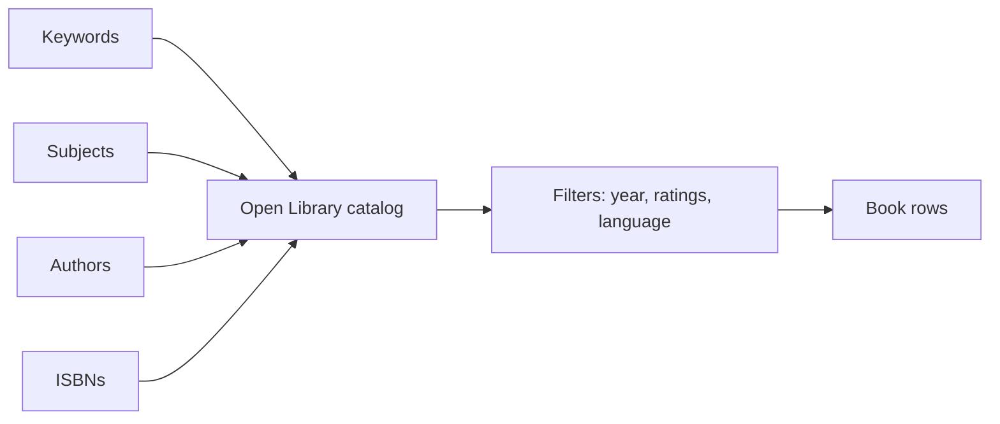

# Book Data Scraper: Ratings, Readers, Subjects and ISBNs from Open Library

[](https://apify.com/Turboextract/open-library-books)
[](LICENSE)
[](#pricing)

**Export book data by keyword, subject, author or ISBN: title, author, first published year, editions, pages, average rating, ratings count, want-to-read and already-read counts, subjects, languages, publishers, ISBNs, and Goodreads and Amazon IDs.** Sort by most read, highest rated or newest. Built on Open Library's open data. No login or API key.

In one test, the search "atomic habits" returned 12 books with reader counts, ISBNs and descriptions in about 6 seconds.

**Try it now →** [apify.com/Turboextract/open-library-books](https://apify.com/Turboextract/open-library-books)

---

## Why this exists

- Book metadata APIs are paid or have tiny free quotas.
- Retail sites hide ISBNs, subjects and reader counts across pages.
- Catalog and recommendation projects need clean rows with IDs.
- Open Library has the data but no bulk export by subject or author.

---

## Who this is for

- **Publishers and authors** researching a genre before writing or launching
- **Booksellers and affiliate sites** building catalogs with ISBNs and Amazon IDs
- **Book apps and recommendation engines** that need metadata and popularity
- **Librarians and researchers** analyzing subjects and publishing history
- **AI teams** building book datasets

---

## What you get

```json
{
  "workId": "OL17930368W",
  "url": "https://openlibrary.org/works/OL17930368W",
  "title": "Atomic Habits",
  "authors": ["James Clear"],
  "firstPublishedYear": 2016,
  "editionCount": 42,
  "pages": 322,
  "ratingAverage": 3.97,
  "ratingsCount": 1502,
  "wantToRead": 59722,
  "alreadyRead": 1779,
  "subjects": ["Habit", "Behavior modification", "Personal Growth"],
  "languages": ["eng", "spa", "fre", "ger", "por"],
  "isbn13": ["9780593189641"],
  "goodreadsIds": ["62221762"],
  "amazonIds": ["B07RFSSYBH"],
  "coverUrl": "https://covers.openlibrary.org/b/id/12539702-L.jpg",
  "description": "No matter your goals, Atomic Habits offers a proven framework for improving every day..."
}
```

---

## How it works



---

## Quick start

1. Click **Try for free**.
2. Add **Search keywords**, **Subjects** like `science fiction`, **Authors** or **ISBNs**.
3. Optional: set **Sort** to Most read or Highest rated.
4. Optional: set **Language**, **First published after** or **Minimum ratings count**.
5. Click **Start**, then export to CSV, JSON, Excel or Google Sheets.

### API

```bash
curl -X POST "https://api.apify.com/v2/acts/Turboextract~open-library-books/run-sync-get-dataset-items?token=YOUR_TOKEN" \
  -H "Content-Type: application/json" \
  -d '{"subjects": ["personal finance"], "sort": "readinglog", "maxResults": 200}'
```

### Python

```python
from apify_client import ApifyClient

client = ApifyClient("YOUR_TOKEN")
run = client.actor("Turboextract/open-library-books").call(run_input={
    "authors": ["Brandon Sanderson"],
    "sort": "rating",
})
for b in client.dataset(run["defaultDatasetId"]).iterate_items():
    print(b["title"], b["firstPublishedYear"], b["wantToRead"])
```

---

## Input fields

| Field | Default | What it does |
|---|---|---|
| `searchQueries` | – | Title, author or topic keywords |
| `subjects` | – | Subjects like romance or cooking |
| `authors` | – | Author names |
| `isbns` | – | ISBN-10 or ISBN-13 |
| `sort` | relevance | Relevance, most read, rating, newest, oldest, editions |
| `language` | – | Three-letter code like eng |
| `publishedAfter` | 0 | First published year floor |
| `minRatingsCount` | 0 | Skip less-rated books |
| `includeDescription` | true | Adds the book description |
| `maxPerQuery` | 0 | Cap per query (0 = none) |
| `maxResults` | 50 | Total cap per run |

---

## Pricing

**$0.001 per book delivered.** 1,000 books cost $1.

| Option | 1,000 books |
|---|---|
| **Book Data Scraper** | **$1** |
| Commercial book metadata APIs | $100+ a month |

---

## Common use cases

- **Genre research**: the most read books in a subject since 2015
- **Catalog building**: ISBNs, covers and descriptions for a store or affiliate site
- **Author pages**: every book by an author with editions and ratings
- **Cross-referencing**: match books to Goodreads and Amazon IDs
- **Datasets**: subjects and descriptions for recommendation models

---

## Tips for best results

- `wantToRead` and `alreadyRead` come from Open Library readers and are a good popularity signal.
- Ratings come from Open Library users, so counts are smaller than on retail sites.
- `goodreadsIds` and `amazonIds` let you join this data with other sources.
- Sort by Most read with a subject to find the classics of any genre.

---

## Pairs well with

- [Apple Podcasts Scraper](https://apify.com/Turboextract/apple-podcasts-leads): podcasts on the same topics
- [Wikipedia Trending Articles](https://apify.com/Turboextract/wikipedia-trending): pageviews for authors and books
- [YouTube Scraper](https://apify.com/Turboextract/youtube-videos-scraper): book reviews and BookTube channels

---

## FAQ

**Do I need an API key?** No. The actor uses Open Library's free public API.

**Is this Goodreads data?** No. It is Open Library data, which includes Goodreads IDs for matching.

**Why is a rating empty?** No Open Library user has rated that book yet.

**How fresh is the data?** It is read live on every run.

**Is it legal?** Open Library is an open, non-profit catalog from the Internet Archive, and its data is free to use.

---

## SEO keywords

book data API, book metadata scraper, Open Library scraper, ISBN lookup bulk, books by subject export, book ratings dataset, author bibliography export, Goodreads alternative data, book catalog CSV, book recommendation dataset

---

## Support

- Actor page: https://apify.com/Turboextract/open-library-books
- Issues and questions: open an issue in this repo
- Community Discord: https://discord.gg/8SrXSCpvgj

Built and maintained by [Turboextract](https://apify.com/Turboextract) on the Apify platform.

---

## License

The documentation and examples in this repository are MIT licensed. The actor itself runs on the Apify platform.
